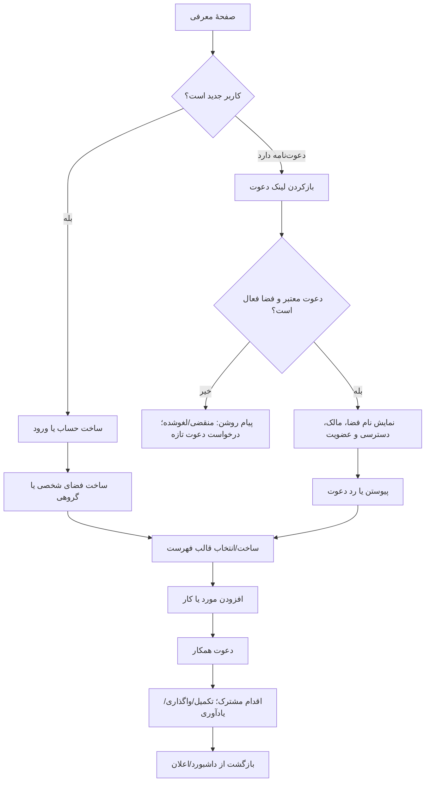

# فلوهای کسب‌وکار و کاربر — هم‌لیست

این سند جریان‌های end-to-end و قواعد محصول را مشخص می‌کند. قابلیت‌هایی که هنوز تصمیم یا پیاده‌سازی نشده‌اند صریحاً با برچسب **فاز بعد** یا **فرضیه** آمده‌اند.

## نقشهٔ کلی سفر کاربر

## اصول مشترک تمام فلوها

- هر صفحه باید حالت‌های `loading`, `empty`, `success`, `error`, `offline` و در صورت نیاز `permission denied` داشته باشد.
- عملیات مهم باید تأیید یا امکان بازگردانی داشته باشد؛ دکمهٔ destructive از عمل عادی جدا و برچسب‌دار باشد.
- پیام خطا باید بگوید چه رخ داده، چه چیزی ذخیره شده/نشده و قدم بعدی چیست.
- هر شیء باید مالک/فضا، زمان ایجاد و آخرین تغییر را داشته باشد.
- فضای جدید خصوصی است؛ هیچ فهرستی با جست‌وجوی عمومی پیدا نمی‌شود.
- همگام‌سازی ایدمپوتنت باشد: ارسال دوبارهٔ درخواست یا refresh یک مورد تکراری نسازد.
- برای تغییر یک مورد در دو دستگاه، آخرین نسخه بی‌صدا اطلاعات قبلی را overwrite نکند؛ تعارض قابل فهم و قابل انتخاب/ادغام باشد.

## F-01 — کشف، ارزش پیشنهادی و ورود

**هدف:** بازدیدکننده سریع بفهمد محصول چه می‌کند و اولین کار را شروع کند.

1. صفحهٔ معرفی یک CTA اصلی دارد: «ساخت اولین فهرست».
2. کنار CTA، نمونهٔ قابل لمس (خرید خانه/کارهای هفته/سفر) دیده می‌شود.
3. کاربر CTA را می‌زند.
4. اگر نشست معتبری دارد به فضای اخیر/فرم ساخت برود؛ در غیر این صورت ورود یا ایجاد حساب.
5. حساب می‌تواند با ایمیل و روش‌های اجتماعیِ تصویب‌شده ساخته شود. ایمیل تأیید شود.
6. پس از برگشت از لینک ورود، کاربر به همان عملیاتی که شروع کرده بود بازگردد.

**لبه‌ها:** لینک ورود منقضی/استفاده‌شده، ایمیل قبلاً ثبت‌شده، بازشدن لینک در دستگاه دیگر، بستن صفحه قبل از تکمیل.  
**قاعده:** اطلاعات مقصد (مثلاً invite URL) در redirect امن حفظ شود، اما توکن invite یا auth در analytics/log عمومی ثبت نشود.

## F-02 — اولین تجربه و ساخت فضا

1. کاربر بین «فضای شخصی» و «فضای مشترک» انتخاب می‌کند.
2. برای فضای مشترک نام کوتاه می‌دهد، مثل «خانه»، «سفر تابستان» یا «گروه ما».
3. می‌تواند نوع قالب را انتخاب کند: خرید، کارها، سفر/رویداد، خالی.
4. هم‌لیست یک نمونهٔ آموزشی اختیاری نشان می‌دهد؛ دادهٔ نمونه با دادهٔ واقعی اشتباه نشود.
5. فهرست ساخته شده و کاربر یک مورد اول را اضافه می‌کند.
6. پس از اولین ارزش، دعوت همکار پیشنهاد می‌شود (قابل رد کردن).

**قواعد:** نام اجباری و طول‌دار، کاراکترهای امن، نام تکراری در یک کاربر مجاز است؛ شناسهٔ فضا یکتا است. حذف onboarding نباید فهرست ساخته‌شده را حذف کند.

## F-03 — ساخت و نگهداری فهرست

**ایجاد:** نام، نوع، فضای والد، رنگ/نماد اختیاری، توضیح اختیاری، تنظیم نمایش اعضا.

**ویرایش:** نام/توضیح، مرتب‌سازی دستی یا آخرین تغییر، بایگانی، بازگردانی از بایگانی.

**حذف:** ابتدا فهرست به بایگانی برود؛ حذف دائمی با هشدار دربارهٔ اقلام و فعالیت‌های وابسته و تأیید مجدد. اگر فهرست دارای دادهٔ قابل بازیابی است، مهلت restore تعریف شود.

**فهرست خالی:** توضیح کاربرد + CTA «افزودن اولین مورد»؛ به جای فضای سفید بی‌راهنما.

## F-04 — افزودن، تکمیل و تغییر مورد

1. کاربر در یک فهرست ورودی سریع «چه چیزی لازم است؟» را می‌بیند.
2. عنوان اجباری؛ تعداد، یادداشت، مسئول و موعد اختیاری‌اند.
3. با افزودن، مورد فوراً در لیست و برای اعضای مجاز همگام می‌شود.
4. تکمیل/بازگشایی با کنترل روشن انجام می‌شود؛ وضعیت، شخص تکمیل‌کننده و زمان در activity ثبت می‌شود.
5. ویرایش inline است؛ لغو، تغییر ذخیره‌نشده را دور می‌اندازد.
6. حذف مورد با undo موقت انجام می‌شود؛ حذف دائمی جداست.
7. مرتب‌سازی در حالت پیش‌فرض «بازها قبل از انجام‌شده‌ها»؛ ترتیب دستی بعداً قابل انتخاب است.

**قواعد:** عنوان خالی ثبت نشود؛ Enter برای افزودن فقط وقتی textarea چندخطی نیست؛ آیتم‌های مشابه پیشنهاد ادغام داده شوند اما خودکار ادغام نشوند.

## F-05 — دعوت و پیوستن عضو

### ارسال دعوت

1. مالک/عضو مجاز «دعوت» را می‌زند.
2. نقش دعوت‌شونده مشخص می‌شود (در MVP ممکن است فقط `member` باشد).
3. یک لینک دعوت با مهلت انقضا و سقف/بدون سقف استفاده ساخته می‌شود.
4. کاربر لینک را کپی یا از share sheet ارسال می‌کند.
5. مالک می‌تواند دعوت را ببیند، لغو کند و در صورت لزوم لینک تازه بسازد.

### دریافت دعوت

1. لینک باز می‌شود؛ صفحه نام فضا، نام/نقش دعوت‌کننده و سطح دسترسی را نشان می‌دهد.
2. دعوت‌کننده وارد حساب می‌شود یا حساب می‌سازد.
3. پیش از عضویت، صفحه اجازهٔ «پیوستن» یا «رد کردن» می‌خواهد.
4. در عضویت موفق، کاربر به فهرست مرتبط هدایت می‌شود و سایر اعضا از پیوستن او مطلع می‌شوند.

**خطاها:** دعوت منقضی، لغوشده، پرشده، فضا حذف/آرشیو، کاربر از قبل عضو است، کاربر مسدود است. برای هرکدام پیام و CTA مناسب (درخواست لینک جدید، رفتن به فضا، بازگشت) نشان بده.

**امنیت:** توکن دعوت تصادفی و غیرقابل حدس، قابل لغو، rate-limited و در logها redacted باشد. لینک فقط دسترسی نقش تعیین‌شده را بدهد.

## F-06 — تخصیص کار و موعد (فاز بعد از هسته)

1. سازندهٔ کار مسئول را از اعضای فضا انتخاب می‌کند یا «بدون مسئول» می‌گذارد.
2. تاریخ/زمان و اولویت اختیاری تعیین می‌کند.
3. مسئول، موعد و قابلیت تغییر مسئول توسط هر عضو، مطابق مجوزها اعمال می‌شود.
4. مسئول، تغییر کار و اعضای مرتبط اعلان می‌گیرند؛ تکرار اعلان برای هر ویرایش جزئی کنترل شود.
5. کار انجام‌شده از فهرست باز جدا می‌شود اما در activity/history می‌ماند.

**قواعد باز:** آیا item خرید همان task است یا دو موجودیت جدا؟ پیشنهاد MVP: یک `ListItem` با `assignee/dueAt/status` اختیاری؛ فقط پس از تحقیق مدل جدا بسازیم.

## F-07 — یادآورها و اعلان‌ها (فاز بعد)

1. کاربر تاریخ/ساعت و نوع اعلان را انتخاب می‌کند.
2. پیش از درخواست مجوز مرورگر، ارزش و نوع اعلان توضیح داده می‌شود.
3. ردشدن مجوز، فلو ایجاد یادآور را از کار نیندازد؛ یادآور در صفحهٔ داخل محصول باقی بماند.
4. اگر push/email پشتیبانی شود، کاربر کانال را opt-in می‌کند و می‌تواند آن را لغو کند.
5. اعلان دارای عنوان، مورد مرتبط، اقدام اصلی و مسیر بازگشت به فهرست است.
6. گزینه‌های `done`, `snooze`, `open`؛ snooze زمان‌های قابل فهم دارد.
7. ساعات سکوت، digest و دسته‌بندی‌ها قابل تنظیم‌اند.

**قواعد:** منطقهٔ زمانی در سطح کاربر نگهداری شود؛ تغییر منطقهٔ زمانی، ساعت یادآور را ناخواسته جابه‌جا نکند. لغو/تکمیل کار، اعلان‌های موعدشدهٔ وابسته را نیز باطل کند.

## F-08 — هزینهٔ مشترک (فاز آزمایشی جداگانه)

1. عضو مبلغ، ارز، شرح، تاریخ و پرداخت‌کننده را وارد می‌کند.
2. اعضای سهیم و روش تقسیم را انتخاب می‌کند: مساوی یا مقدار/درصد سفارشی.
3. قبل از ثبت، سهم هر عضو و گردکردن نمایش داده می‌شود.
4. پس از ثبت، اعضا می‌توانند رسید/یادداشت اختیاری اضافه کنند.
5. «تسویه‌شده» فقط ثبت وضعیت دستی است؛ هیچ انتقال پولی انجام نمی‌شود.
6. ویرایش/حذف هزینه در activity ثبت می‌شود و به اعضای متاثر اعلان مناسب می‌دهد.

**خارج از scope:** اتصال بانکی، نگهداری کارت، انتقال پول، وعدهٔ محاسبهٔ مالیاتی. دقت اعداد اعشاری و واحد پول باید بر اساس بازار/ارز تصمیم گرفته شود.

## F-09 — مرکز اعلان‌ها

- انواع: دعوت، عضویت، واگذاری کار، اشاره/تغییر مهم، موعد، یادآوری، اشتراک/حساب.
- گروه‌بندی اعلان‌های پرتکرار؛ خوانده‌شده/نشده و «همه را خوانده‌شده کن».
- تنظیمات per-user برای نوع/کانال؛ هشدار امنیتی/دعوت مهم نباید با اعلان عادی یکی شود.
- کلیک، کاربر را به موجودیت مربوط و وضعیت فعلی می‌برد؛ موجودیت حذف‌شده صفحهٔ خطای روشن داشته باشد.

## F-10 — نقش، عضویت و مالکیت

**نقش‌های پیشنهادی:**

- `owner`: تنظیمات فضا، دعوت/حذف عضو، انتقال مالکیت، حذف فضا.
- `member`: مشاهده و تغییر فهرست/کار مطابق تنظیمات فضا.
- `viewer` (اختیاری، بعداً): مشاهده بدون تغییر.

**قواعد:** عضو خارج‌شده دسترسی فوری از دست بدهد؛ لینک دعوت باطل شود؛ محتوا مطابق retention باقی بماند. انتقال مالکیت باید تأیید گیرنده داشته باشد. خروج آخرین مالک ممکن نباشد مگر مالکیت منتقل یا فضا حذف شود.

## F-11 — مدل رایگان/پولی (فرضیهٔ تجاری)

این فلو تا زمان اعتبارسنجی رایگان است و قابلیت پرداخت، UI قطعی ندارد.

1. وقتی کاربر به محدودیت قابل توضیح رسید، دلیل محدودیت و مقدار مصرف نمایش داده شود.
2. صفحهٔ plan، قیمت/دوره/محدودیت/لغو را قبل از تأیید کامل نشان دهد.
3. خرید → تأیید سرور → فعال‌سازی entitlement → رسید و تاریخ تمدید.
4. پرداخت ناموفق، لغو renewal، refund و پایان دوره باید حالت‌های جدا داشته باشند.
5. لغو پرداخت نباید دادهٔ گروه را بی‌هشدار حذف کند؛ محدودیت downgrade از پیش توضیح داده شود.

## F-12 — تنظیمات حساب، حریم خصوصی و خروج

- ویرایش نام، زبان، منطقهٔ زمانی، ترجیحات اعلان.
- خروج از این دستگاه و خروج از همهٔ نشست‌ها.
- export داده‌ها با پیام آماده‌شدن و لینک امن مدت‌دار.
- درخواست حذف حساب: تأیید هویت، نمایش اثر بر فضاهای تحت مالکیت، انتقال/حذف گروه، مهلت بازگشت در صورت وجود، اجرای حذف و تأیید نهایی.
- حذف حساب نباید مالکیت بدون صاحب ایجاد کند؛ گروه باید انتقال مالکیت یا بستن را طی کند.

## F-13 — پشتیبانی، گزارش و سوءاستفاده

- گزارش فضا/دعوت/محتوای نامناسب از منوی مرتبط.
- محدودیت rate برای ایجاد فضا، دعوت و اعلان.
- مالک می‌تواند عضو را remove کند؛ عضو می‌تواند صاحب را report یا فضا را ترک کند.
- مسیر تماس پشتیبانی، شناسهٔ رخداد و وضعیت درخواست.
- ابزار moderation فقط در صورت انتشار عمومی/افزایش مقیاس طراحی می‌شود؛ دسترسی پشتیبانی به محتوای خصوصی باید حداقلی و audit شود.

## F-14 — قطع اینترنت، تعارض و بازیابی

- برچسب اتصال/آخرین همگام‌سازی.
- در قطع موقت، ورودی کاربر پاک نشود؛ پیش‌نویس/صف تغییر با وضعیت «در انتظار ارسال» نشان داده شود.
- retry با backoff و idempotency؛ تکرار مورد یا دعوت ایجاد نکند.
- تعارض ویرایش با نمایش نسخهٔ server/local و انتخاب/ادغام، نه overwrite خاموش.
- حذف/بایگانی و عملیات حساس در queue آفلاین اجرا نشود مگر قواعدش کاملاً امن باشد.

## F-15 — نصب PWA و حالت آفلاین

### نصب

1. سایت از HTTPS اجرا می‌شود و Web App Manifest معتبر دارد.
2. اگر مرورگر event نصب خودکار را پشتیبانی کند، یک CTA غیرمزاحم «نصب هم‌لیست» نشان داده می‌شود؛ prompt بدون کلیک کاربر باز نشود.
3. در مرورگرهایی که prompt درون‌برنامه‌ای ندارند، راهنمای «افزودن به صفحهٔ اصلی» مخصوص همان پلتفرم نمایش داده شود.
4. پس از نصب، برنامه در حالت standalone باز شود؛ کاربر همچنان بتواند به سایت وب برگردد.
5. ردکردن نصب باعث promptهای مکرر نشود؛ گزینه از تنظیمات قابل دسترسی بماند.

### آفلاین و به‌روزرسانی

- پوسته و صفحه‌های استاتیک cache می‌شوند؛ پاسخ‌های خصوصی فقط با سیاست scoped و پاک‌سازی امن cache شوند.
- هنگام آفلاین‌شدن، برچسب وضعیت اتصال و زمان آخرین sync دیده شود.
- دادهٔ cache‌شده با «دادهٔ تازه» اشتباه نشود؛ تغییر ذخیره‌نشده برچسب pending داشته باشد.
- در MVP، ثبت تغییر آفلاین می‌تواند به‌صورت پیش‌نویس نگه داشته شود؛ ارسال خودکار تغییرات تنها پس از طراحی versioning، idempotency و حل تعارض فعال شود.
- هنگام ورود کاربر دیگر یا logout، دادهٔ cache شدهٔ حساب قبلی پاک شود.
- service worker جدید با پیام «نسخهٔ جدید آماده است» ارائه شود؛ refresh خودکار وسط فرم/ویرایش انجام نشود.

## فلوهای حیاتی برای آزمون انتهابه‌انتها

1. عضو جدید دعوت لینک معتبر را می‌پذیرد و فقط همان گروه را می‌بیند.
2. دعوت لغوشده و منقضی‌شده اجازهٔ عضویت نمی‌دهد.
3. عضو مجاز item را تکمیل می‌کند و تغییر در عضو دوم دیده می‌شود.
4. عضو خارج‌شده با تب قدیمی دیگر نمی‌تواند بنویسد.
5. owner خارج می‌شود: انتقال مالکیت یا حذف گروه الزامی است.
6. قطع شبکه هنگام افزودن: item گم یا تکراری نمی‌شود.
7. مجوز اعلان رد می‌شود: reminder داخل محصول همچنان قابل مشاهده است.
8. کاربر حساب را حذف می‌کند: هیچ فضای بی‌مالک یا دادهٔ اعلام‌نشده باقی نمی‌ماند.
